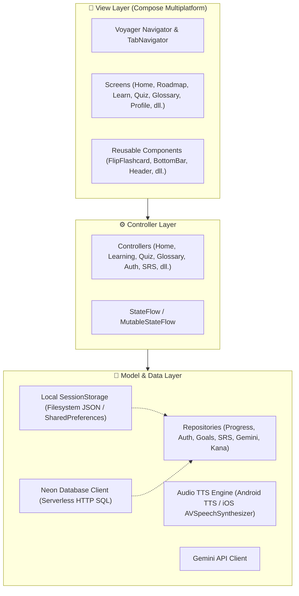

# 🇯🇵 Kotoba Learn (言葉) — Dokumentasi Alur & Fitur Aplikasi Lengkap

Dokumen ini menjelaskan secara menyeluruh arsitektur, alur pengguna (*user flow*), seluruh fitur aplikasi, kurikulum 12 level, sistem persistensi data, serta integrasi kecerdasan buatan (AI) pada **Kotoba Learn**.

---

## 📑 Daftar Isi

1. [Tentang Kotoba Learn](#1-tentang-kotoba-learn)
2. [Arsitektur Sistem & Teknologi](#2-arsitektur-sistem--teknologi)
3. [Alur Aplikasi Lengkap (User Flow)](#3-alur-aplikasi-lengkap-user-flow)
4. [Penjelasan Detail Seluruh Fitur & Layar](#4-penjelasan-detail-seluruh-fitur--layar)
   - [4.1. Splash, Onboarding & Autentikasi](#41-splash-onboarding--autentikasi)
   - [4.2. Goal Quiz (Personalisasi Belajar)](#42-goal-quiz-personalisasi-belajar)
   - [4.3. Tab 1: Home (Beranda & Dashboard)](#43-tab-1-home-beranda--dashboard)
   - [4.4. Tab 2: Roadmap (Peta Kurikulum 12 Level)](#44-tab-2-roadmap-peta-kurikulum-12-level)
   - [4.5. Tab 3: Flashcard Belajar Interaktif](#45-tab-3-flashcard-belajar-interaktif)
   - [4.6. Tab 4: Sensei AI & Kamus Glossary](#46-tab-4-sensei-ai--kamus-glossary)
   - [4.7. Tab 5: Profil & Statistik Pengguna](#47-tab-5-profil--statistik-pengguna)
   - [4.8. Fitur Kuis Interaktif (Quiz Engine)](#48-fitur-kuis-interaktif-quiz-engine)
   - [4.9. Fitur Spaced Repetition System (SRS Review)](#49-fitur-spaced-repetition-system-srs-review)
   - [4.10. Fitur Percakapan Interaktif AI (Roleplay Chat)](#410-fitur-percakapan-interaktif-ai-roleplay-chat)
5. [Struktur Kurikulum Materi (12 Level)](#5-struktur-kurikulum-materi-12-level)
6. [Mekanisme Penyimpanan & Sinkronisasi Cloud](#6-mekanisme-penyimpanan--sinkronisasi-cloud)
7. [Panduan Build & Menjalankan Aplikasi](#7-panduan-build--menjalankan-aplikasi)

---

## 1. Tentang Kotoba Learn

**Kotoba Learn (言葉)** adalah aplikasi pembelajaran bahasa Jepang lintas platform (*cross-platform*) modern yang dirancang untuk membawa pembelajar dari nol (buta huruf Jepang) hingga mampu memahami percakapan sehari-hari dan budaya pop/anime.

### Prinsip Utama Aplikasi:
- **Audio-First**: Setiap huruf, kosakata, dan kalimat contoh dilengkapi audio pelafalan native berkecepatan natural.
- **Anime & Pop-Culture Context**: Kosakata dan contoh kalimat menggunakan rujukan yang dekat dengan penggemar budaya Jepang modern (*ikuzo, kawaii, arigatou, sugoi*).
- **Mnemonic-Rich**: Menghubungkan bentuk huruf Jepang dengan visualisasi memori yang imajinatif.
- **Offline-First & Cloud-Synced**: Data progres dapat diakses tanpa koneksi internet dan otomatis tersinkronisasi ke cloud saat online.
- **AI-Powered**: Terintegrasi langsung dengan Google Gemini Flash untuk bimbingan Sensei personal, analisis tata bahasa, dan simulasi percakapan kontekstual.

---

## 2. Arsitektur Sistem & Teknologi

Aplikasi dibangun menggunakan prinsip **Model-View-Controller (MVC)** yang bersih dan terpisah:



### Tech Stack:
| Komponen | Teknologi |
|---|---|
| **Framework UI** | Compose Multiplatform (JetBrains) 1.7.3 |
| **Bahasa Pemrograman** | Kotlin 2.1.0 Multiplatform (KMP) |
| **Navigasi** | Voyager (Navigator, TabNavigator, Screen Transitions) |
| **Target Platform** | Android (SDK 35), iOS (Arm64), Desktop JVM |
| **Database Cloud** | Neon PostgreSQL (Serverless HTTP SQL) |
| **AI Intelligence** | Google Gemini 1.5/2.0 Flash REST API |
| **Audio Engine** | Android `TextToSpeech` & iOS `AVSpeechSynthesizer` (via `expect/actual`) |
| **Penyimpanan Lokal** | `SessionStorage` (iOS sandbox Documents, Android SharedPreferences, Desktop ~/.kotoba) |

---

## 3. Alur Aplikasi Lengkap (User Flow)

Berikut diagram alur pengguna sejak aplikasi pertama kali dibuka hingga menjalani sesi belajar harian:

```mermaid
flowchart TD
    Start([🚀 Buka Aplikasi]) --> Splash[SplashScreen]
    Splash --> CheckAuth{Sudah Login?}
    
    CheckAuth -- Belum --> Onboarding[OnboardingScreen]
    Onboarding --> Auth[AuthScreen: Login / Register]
    Auth --> GoalCheck{Sudah Isi Goal Quiz?}
    
    CheckAuth -- Sudah --> GoalCheck
    GoalCheck -- Belum --> GoalQuiz[GoalQuizScreen: Penempatan & Target]
    GoalQuiz --> MainTabs
    GoalCheck -- Sudah --> MainTabs[MainTabsScreen: Bottom Navigation]

    subgraph MainTabsFlow ["🏠 Siklus Utama Aplikasi (5 Bottom Tabs)"]
        MainTabs --> TabHome["1. Home Tab"]
        MainTabs --> TabRoadmap["2. Roadmap Tab"]
        MainTabs --> TabLearn["3. Flashcard Tab"]
        MainTabs --> TabGlossary["4. Sensei AI Tab"]
        MainTabs --> TabProfile["5. Profil Tab"]
    end

    TabHome --> |Klik Lanjut Belajar / Node| LearnScreen[LearningScreen: Flashcard 3D]
    TabRoadmap --> |Pilih Level Terbuka| LearnScreen
    TabHome --> |Klik Ulangan Harian| ReviewScreen[ReviewSessionScreen: SRS Flashcard]
    TabHome --> |Klik Chat AI| AiChat[AiConversationScreen: Roleplay]

    LearnScreen --> |Selesai Membaca Materi| QuizScreen[QuizScreen: 4 Tipe Soal Kuis]
    QuizScreen --> |Lulus (Skor >= 70)| QuizPass[🏆 Reward XP & Koin + Unlock Level Berikutnya]
    QuizScreen --> |Belum Lulus| QuizFail[Ulangi Belajar]
    
    QuizPass --> AutoSync[☁️ Auto-Sync Progres ke Neon Database]
    AutoSync --> TabRoadmap
```

---

## 4. Penjelasan Detail Seluruh Fitur & Layar

### 4.1. Splash, Onboarding & Autentikasi
* **Splash Screen (`SplashScreen.kt`)**:
  - Menampilkan logo animasi Kotoba Learn dan kutipan inspiratif Jepang.
  - Memeriksa token otentikasi lokal secara asynchronous dalam milidetik.
* **Onboarding (`OnboardingScreen.kt`)**:
  - Carousel pengenalan interaktif: *Belajar Bahasa Jepang Asik*, *Konteks Budaya & Anime Populer*, dan *Spaced Repetition System*.
* **Autentikasi (`AuthScreen.kt`)**:
  - Dukungan mode **Masuk (Login)** dan **Daftar (Register)**.
  - Validasi email dan password secara realtime.
  - Menyimpan sesi JWT secara persisten ke penyimpanan lokal.

---

### 4.2. Goal Quiz (Personalisasi Belajar)
* **Layar**: `GoalQuizScreen.kt`
* **Tujuan**: Memetakan target dan level awal pengguna agar kurikulum terasa pas.
* **3 Langkah Penempatan**:
  1. **Tujuan Utama**: Belajar untuk Menonton Anime Tanpa Subtitle, Persiapan JLPT, Liburan ke Jepang, atau Pekerjaan/Studi.
  2. **Tingkat Kemampuan Saat Ini**: Nol mutlak, sedikit tahu Hiragana, atau sudah bisa membaca dasar.
  3. **Komitmen Waktu Harian**: Santai (5 menit/hari), Reguler (15 menit/hari), atau Intensif (30 menit/hari).
* **Hasil**: Menentukan kuota target harian di Beranda dan membuka level awal yang sesuai.

---

### 4.3. Tab 1: Home (Beranda & Dashboard)
* **Layar**: `HomeScreen.kt`
* **Elemen & Fitur**:
  1. **Top Header**:
     - Avatar pengguna & sapaan personalisasi (*Konnichiwa, [Nama]*).
     - **Streak Counter**: Menghitung hari belajar beruntun untuk menjaga konsistensi harian.
     - **XP & Coin Counter**: Indikator gamifikasi yang diperoleh dari kuis dan review.
  2. **Daily Goal Ring**:
     - Cincin progres harian yang terisi setiap kali menyelesaikan kuis atau review.
  3. **Hero Banner ("Lanjut Belajar")**:
     - Menampilkan level aktif terakhir pengguna beserta tombol aksi cepat untuk langsung kembali belajar tanpa repot mencari.
  4. **Kotak Ulangan Harian (SRS Review Banner)**:
     - Menginformasikan jumlah kartu memori yang jatuh tempo hari ini berdasarkan algoritma SM-2.
     - Tombol cepat untuk memulai sesi ulangan.
  5. **Action Menu Grid**:
     - Pintasan cepat ke **Percakapan AI**, **Tanya Sensei**, **Kamus Lengkap**, dan **Roadmap**.
  6. **Kana Mastery Counter**:
     - Menghitung persentase total huruf Hiragana dan Katakana yang telah dikuasai (*Mastered*).

---

### 4.4. Tab 2: Roadmap (Peta Kurikulum 12 Level)
* **Layar**: `RoadmapScreen.kt`
* **Fitur**:
  - Visualisasi alur belajar meliuk vertikal dari Level 1 hingga Level 12.
  - **Sistem Gembok (Locking Engine)**:
    - Level 1 terbuka secara bawaan.
    - Level selanjutnya hanya terbuka jika kuis di level sebelumnya berstatus **Lulus** (`isQuizPassed = true`).
  - **Status Card Level**:
    - 🔒 **Terkunci (*Locked*)**: Ditandai ikon gembok abu-abu, tidak bisa dibuka sebelum lulus level sebelumnya.
    - ⏳ **Sedang Dipelajari (*In Progress*)**: Level yang sedang aktif, diberi highlight warna aksen cerah.
    - ✅ **Selesai (*Completed*)**: Diberi centang emas dengan tampilan **Skor Tertinggi (*High Score*)** yang diraih pengguna.

---

### 4.5. Tab 3: Flashcard Belajar Interaktif
* **Layar**: `LearningScreen.kt` & [FlipFlashcard.kt](file:///d:/flutter_project/kmp_japaneseapp/composeApp/src/commonMain/kotlin/id/kotoba/app/view/components/FlipFlashcard.kt)
* **Fitur**:
  1. **Animasi 3D Flip Card**:
     - Sentuh kartu untuk membalik secara halus 180 derajat antara sisi depan dan belakang.
  2. **Sisi Depan Kartu**:
     - Karakter Jepang berukuran besar (Hiragana/Katakana/Kanji).
     - **Romaji Pill Badge**: Panduan cara baca huruf latin.
     - Stroke Order / Petunjuk urutan goresan penulisan.
     - **Tombol Audio TTS**: Memperdengarkan pelafalan resmi suara penutur asli Jepang.
  3. **Sisi Belakang Kartu**:
     - Arti dalam Bahasa Indonesia.
     - **Contoh Kosakata Nyata**: Kosakata turunan yang menggunakan karakter tersebut lengkap dengan audio dan artinya.
     - **Visual Mnemonic Story**: Cerita memori visual unik untuk mengaitkan bentuk huruf dengan objek sehari-hari (misal: *Huruf "あ" (a) mirip apel yang ada tangkainya*).
  4. **Sensei AI Mnemonic Generator**:
     - Tombol integrasi Gemini AI untuk meminta tips memori visual alternatif jika pengguna kesulitan menghafal.
  5. **Tandai Dikuasai (*Mark as Mastered*)**:
     - Pengguna dapat menandai huruf yang sudah hafal di luar kepala. Status ini otomatis tersimpan ke lokal dan cloud.
  6. **Navigasi Carousel & Transisi Kuis**:
     - Tombol Sebelumnya / Selanjutnya dan indikator progres nomor kartu.
     - Di akhir kartu, muncul tombol **"Mulai Kuis Level Ini"** untuk menguji pemahaman.

---

### 4.6. Tab 4: Sensei AI & Kamus Glossary
* **Layar**: `GlossaryScreen.kt`
* **Fitur**:
  1. **Kamus Interaktif 4 Kategori**:
     - Tab **Hiragana**, **Katakana**, **Kanji**, dan **Kosakata Populer**.
  2. **Pencarian Realtime**:
     - Filter instan berdasarkan huruf Jepang, romaji, atau arti bahasa Indonesia.
  3. **Audio Speaker Terintegrasi**:
     - Setiap item di kamus memiliki tombol audio untuk mendengarkan lafal pengucapannya.
  4. **Tanya Sensei AI (Gemini Flash)**:
     - Kotak interaktif bertenaga Gemini AI untuk mengajukan pertanyaan apa pun seputar tata bahasa (*grammar*), perbedaan partikel (misal: *Wa vs Ga*), nuansa kata, dan etika berbicara dalam budaya Jepang.
     - Menyediakan tombol *Quick Chips* pertanyaan populer sekali klik.

---

### 4.7. Tab 5: Profil & Statistik Pengguna
* **Layar**: `ProfileScreen.kt`
* **Fitur**:
  1. **Identitas Pengguna**: Nama akun, email, dan avatar profil.
  2. **Dashboard Statistik Belajar**:
     - Total Perolehan XP & Koin.
     - Jumlah hari Streak belajar.
     - Total karakter/kosakata yang telah dikuasai.
     - Tingkat akurasi jawaban kuis.
  3. **Tinjauan Target Belajar**:
     - Menampilkan kembali komitmen waktu harian dan fokus belajar yang dipilih saat Goal Quiz.
  4. **Pengaturan & Logout**:
     - Tombol tes Audio TTS untuk memastikan mesin suara perangkat berfungsi.
     - Tombol Keluar Akun (*Logout*) yang membersihkan sesi secara aman.

---

### 4.8. Fitur Kuis Interaktif (Quiz Engine)
* **Layar**: `QuizScreen.kt`
* **Fitur**:
  1. **4 Ragam Tipe Soal Dinamis**:
     - **Pilihan Ganda Karakter**: Menentukan huruf yang sesuai untuk suatu romaji/lafal.
     - **Tebak Suara (Audio Quiz)**: Mendengarkan audio pelafalan dan memilih karakter yang tepat.
     - **Tebak Arti Kosakata**: Memilih arti bahasa Indonesia yang benar dari kata Jepang.
     - **Romaji Matcher**: Mencocokkan ejaan romaji dengan karakter kanji/kana.
  2. **Mekanisme Gamifikasi**:
     - **Nyawa (Hearts)**: Batas toleransi kesalahan (3 nyawa).
     - **Timer Per Soal**: Mendorong kecepatan daya ingat spontan.
     - Feedback warna (Hijau jika benar, Merah jika keliru) dan suara interaktif.
  3. **Layar Hasil & Perayaan**:
     - Animasi **Confetti Celebration (`ConfettiView.kt`)** saat lulus kuis.
     - Pembagian Reward: XP, Koin, dan pembukaan otomatis level selanjutnya pada Roadmap.
     - Auto-sync nilai tertinggi (*High Score*) ke cloud database Neon Postgres.

---

### 4.9. Fitur Spaced Repetition System (SRS Review)
* **Layar**: `ReviewSessionScreen.kt`
* **Algoritma**: SuperMemo SM-2 berbasis repetisi berjarak.
* **Cara Kerja**:
  1. Sistem melacak setiap item yang dipelajari dan menghitung tingkat kesulitan serta faktor kemudahan (*Ease Factor*).
  2. Pengguna menilai sendiri daya ingat mereka:
     - 🔴 **Again (Ulangi)**: Lupa total (diulang dalam sesi yang sama).
     - 🟠 **Hard (Sulit)**: Ingat dengan susah payah (interval pendek).
     - 🟢 **Good (Bagus)**: Ingat dengan wajar (interval standar bertambah).
     - 🔵 **Easy (Sangat Mudah)**: Hafal luar kepala (interval berlipat ganda).
  3. Mencegah fenomena *Forgetting Curve* (kurva lupa) sehingga materi lama tetap menempel di ingatan jangka panjang.

---

### 4.10. Fitur Percakapan Interaktif AI (Roleplay Chat)
* **Layar**: `AiConversationScreen.kt`
* **Fitur**:
  - Simulasi percakapan kontekstual dua arah dengan kecerdasan buatan Gemini AI.
  - **Pilihan Skenario Nyata**:
    - Memesan makanan & minuman di Restoran Jepang.
    - Berbelanja di Konbini (Convenience Store).
    - Bertanya arah jalan di stasiun Tokyo.
    - Perkenalan diri santai dengan teman baru.
  - **Dukungan dwibahasa**: Setiap pesan menyertakan teks Jepang (lengkap dengan Romaji) dan terjemahan Bahasa Indonesia.
  - **Audio Readout**: Tombol audio untuk mendengarkan pelafalan tiap balon chat AI.
  - **Koreksi Tata Bahasa Cerdas**: Jika pengguna salah mengetik partikel atau kata kerja, AI memberikan koreksi ramah di bawah pesan.

---

## 5. Struktur Kurikulum Materi (12 Level)

Kurikulum dirancang secara pedagogis dalam 4 Fase progresif di [KanaRepository.kt](file:///d:/flutter_project/kmp_japaneseapp/composeApp/src/commonMain/kotlin/id/kotoba/app/model/repository/KanaRepository.kt):

| Level | Kode | Nama Level | Fase | Materi Pembelajaran | Jml Soal Kuis |
|---|---|---|---|---|---|
| **1** | `lvl_1` | Hiragana Inti (Seion) | Fase A: Fondasi Kana | Huruf vokal dan baris dasar: あ, い, う, え, お, か, き, く, け, こ | 4 Soal |
| **2** | `lvl_2` | Hiragana Dakuon | Fase A: Fondasi Kana | Bunyi tebal (Tenten & Maru): が, ぎ, ざ, じ, だ, ぢ, ば, ぱ | 3 Soal |
| **3** | `lvl_3` | Youon & Sokuon | Fase A: Fondasi Kana | Kombinasi kecil (kya, kyu, kyo) dan konsonan ganda (tsu kecil) | 2 Soal |
| **4** | `lvl_4` | Kosakata Ikonik Anime | Fase B: Kosakata & Katakana | Kata populer: ありがとう, かわいい, すごい, いくぞ, やった | 2 Soal |
| **5** | `lvl_5` | Katakana Dasar | Fase B: Kosakata & Katakana | Kata serapan asing: コーヒー, アニメ, パン, テレビ | 2 Soal |
| **6** | `lvl_6` | Partikel & Frase Dasar | Fase C: Kanji & Tata Bahasa | Partikel fundamental: は (wa), を (o), の (no) dan kalimat dasar | 2 Soal |
| **7** | `lvl_7` | Kanji Angka & Waktu | Fase C: Kanji & Tata Bahasa | Angka dasar kanji: 一 (ichi), 二 (ni), 三 (san), 日 (hari), 月 (bulan) | 2 Soal |
| **8** | `lvl_8` | Kanji Kehidupan Sehari-hari | Fase C: Kanji & Tata Bahasa | Kanji alam & tempat: 人 (orang), 水 (air), 火 (api), 木 (pohon), 山 (gunung) | 2 Soal |
| **9** | `lvl_9` | Pola Kalimat -masu & Kerja | Fase C: Kanji & Tata Bahasa | Kata kerja sopan: たべます, のみます, いきます, みます | 3 Soal |
| **10** | `lvl_10` | Perkenalan Diri (Jikoshoukai) | Fase D: Percakapan & Listening | Frase sapaan: はじめまして, よろしくおねがいします, わたしは... | 4 Soal |
| **11** | `lvl_11` | Situasi Sehari-hari & Konbini | Fase D: Percakapan & Listening | Transaksi belanja: これをください, いくらですか, だいじょうぶです | 4 Soal |
| **12** | `lvl_12` | Evaluasi Akhir & Listening | Fase D: Percakapan & Listening | Tes komprehensif listening dan pemahaman percakapan mandiri | 5 Soal |

---

## 6. Mekanisme Penyimpanan & Sinkronisasi Cloud

### 1. Dual-Layer Storage Strategy
1. **Lokal (*Local-First*)**:
   - Disimpan melalui `SessionStorage` menggunakan file JSON terisolasi di direktori Dokumen aplikasi (iOS), SharedPreferences (Android), atau user home folder (Desktop).
   - Memastikan aplikasi dapat dibuka secara instan tanpa layar loading jaringan dan tetap berfungsi penuh saat pengguna offline di pesawat/kereta.
2. **Cloud (*PostgreSQL di Neon Serverless*)**:
   - Sinkronisasi menggunakan protokol HTTP SQL RESTful langsung ke pooler Neon.
   - Menggunakan query `UPSERT`:
     ```sql
     INSERT INTO user_progress (user_id, level_id, status, high_score, is_quiz_passed, mastered_kana_ids, updated_at)
     VALUES ($1, $2, $3, $4, $5, $6::text[], CURRENT_TIMESTAMP)
     ON CONFLICT (user_id, level_id)
     DO UPDATE SET
         status = EXCLUDED.status,
         high_score = GREATEST(user_progress.high_score, EXCLUDED.high_score),
         is_quiz_passed = user_progress.is_quiz_passed OR EXCLUDED.is_quiz_passed,
         mastered_kana_ids = EXCLUDED.mastered_kana_ids,
         updated_at = CURRENT_TIMESTAMP;
     ```
   - Dengan klausa `GREATEST` dan `OR`, data progres tertinggi pengguna tidak akan pernah tertimpa atau hilang jika login dari perangkat yang berbeda.

---

## 7. Panduan Build & Menjalankan Aplikasi

### Persyaratan Lingkungan:
- JDK 17 atau JDK 21 (misal dari JetBrains Runtime Android Studio: `D:\Androidstudio\jbr`).
- Gradle 8.11.1 (tersedia melalui wrapper `gradlew`).
- Android SDK 35 (untuk Android target).
- macOS dengan Xcode (hanya diperlukan jika mengompilasi binary target iOS).

### Perintah Build & Run:

#### Menjalankan di Desktop (Windows/macOS/Linux):
```powershell
$env:JAVA_HOME = "D:\Androidstudio\jbr"
.\gradlew.bat :composeApp:run
```

#### Menghasilkan Android Debug APK:
```powershell
$env:JAVA_HOME = "D:\Androidstudio\jbr"
.\gradlew.bat :composeApp:assembleDebug
```
*File APK hasil kompilasi akan berada di*: `composeApp/build/outputs/apk/debug/composeApp-debug.apk`.

#### Memeriksa Kompilasi iOS (Kotlin Native):
```bash
./gradlew :composeApp:compileKotlinIosArm64
```
*(Dijalankan pada mesin macOS atau pipeline CI/CD seperti Codemagic).*

---

*Dokumentasi ini mencakup seluruh fitur, alur kerja, dan arsitektur aktif Kotoba Learn per pembaruan terkini.*
